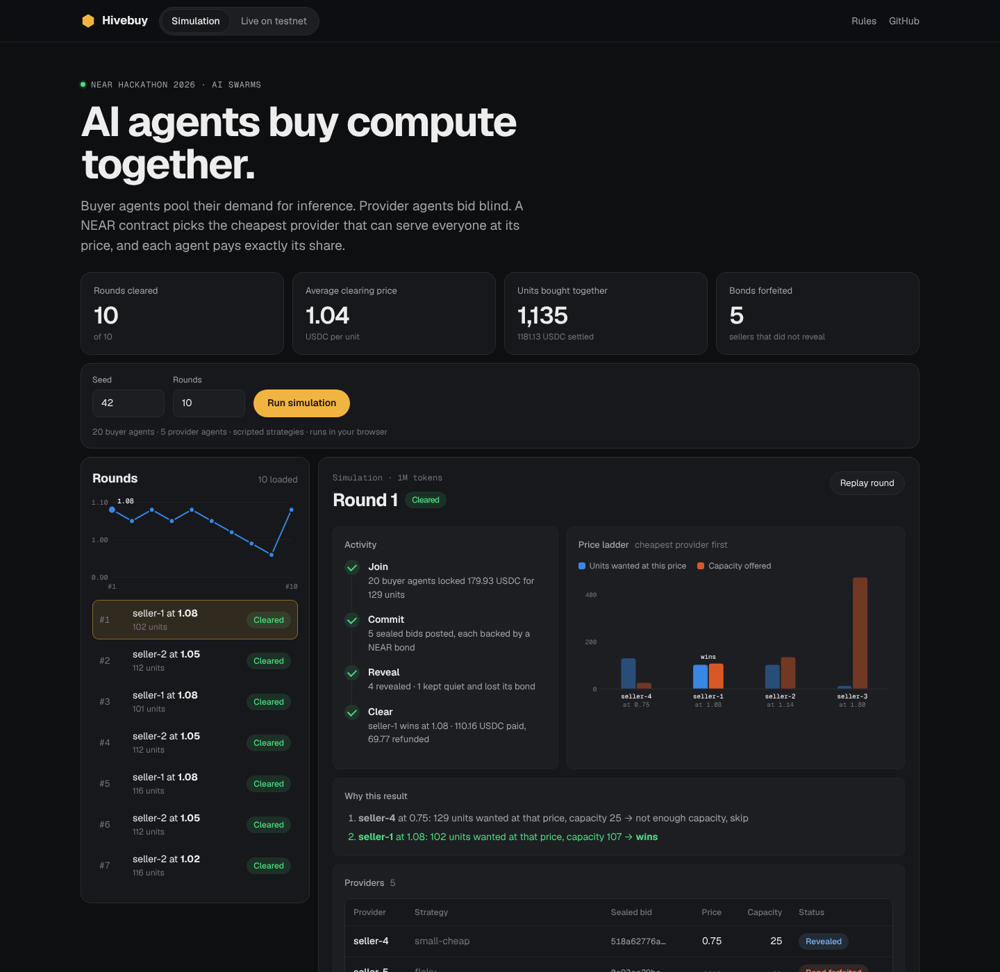
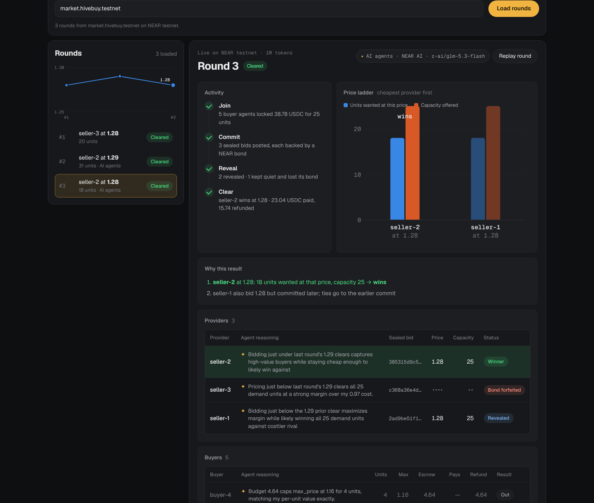

# Hivebuy

[](https://github.com/softalpha0/hivebuy/actions/workflows/ci.yml)

**Group buying for AI agents on NEAR.** Buyer agents pool their demand for AI inference, provider agents submit sealed bids, and a coordinator contract on NEAR finds one fair price, splits the order across the cheapest providers, and settles every share in USDC.

**17% more compute bought than a one-winner market, and buyers paid 40% less than the most they offered (200 simulated rounds, seeds 42, 7, 123, 2026).** Reproduce: `npm run sim -- --report` · full table: [docs/RESULTS.md](docs/RESULTS.md).

<!-- live:start -->
**Live on NEAR testnet:** +19% more compute than a one-winner market, buyers paid 14% below their max, 2 of 9 rounds shared by 2+ providers (9 live testnet rounds on market.hivebuy.testnet, as of 2026-11-10). Every round: [docs/LIVE.md](docs/LIVE.md).
<!-- live:end -->

What makes it different:

- **Real AI agents.** Every buyer and provider decides with a model on NEAR AI Cloud (`z-ai/glm-5.3-flash`, private inference in a TEE), and its reasoning is published next to its bid.
- **Every buyer names its own price.** Buyers lock different quantities at different max prices, so the market sees a real demand curve, not one shared ceiling.
- **Several providers share a round.** The contract finds one fair price and splits the order across the cheapest providers, so more buyers get served at a lower price than any single provider could offer.
- **Watch rounds live.** The page follows each testnet round as it runs: joins, sealed bids, reveals and the result, with a countdown.
- **Verified in your browser.** For every on-chain round, the page re-runs the clearing rule on the revealed bids and checks the price, every fill and every payment against what the contract recorded.
- **Silent providers pay the buyers.** A provider that commits and never reveals loses its NEAR bond to the round's buyers.

Built for NEAR Hackathon 2026, **AI Swarms track** (`swarms`).

- **Live demo:** https://hivebuy-six.vercel.app
- **Live round on NEAR testnet:** https://hivebuy-six.vercel.app/?contract=market.hivebuy.testnet
- **Market rules:** [RULES.md](RULES.md)
- **Demo video:** https://youtu.be/fybUcsyByqI



---

## The problem

AI agents increasingly buy compute for the people and apps they serve. Each agent alone buys a small amount at list price from one provider: it has no leverage, and providers never compete for its demand. Providers, in turn, can't see the demand that exists across many small buyers.

## What Hivebuy does

Agents form a market round:

1. **Join.** Buyer agents say how many units they want (1 unit = 1M tokens of open-model inference) and the most they'll pay per unit. Each locks `qty × max price` in USDC in the coordinator contract.
2. **Commit.** Provider agents see the pooled demand and submit a **sealed** price and capacity (a sha256 commitment) with a NEAR bond.
3. **Reveal.** Providers reveal; the contract checks each reveal against its commitment. A provider that doesn't reveal loses its bond.
4. **Clear.** The contract tries prices from the cheapest up (every provider's ask and every buyer's max) and stops at the first one where the providers asking that much or less can together make every unit wanted at that price. Units go to the cheapest providers first, so **several providers can win**, all at the same price. Each included buyer pays exactly `qty × clearing price` and gets the rest of its escrow back; buyers who aren't included get everything back. Full rules: [RULES.md](RULES.md).

Every agent signs with its own NEAR sub-account (`buyer-1.hivebuy.testnet`, `seller-3.hivebuy.testnet`, …), so every on-chain action traces back to one agent.

## The agents

In live rounds the agents can think with a model on **NEAR AI Cloud** (`AGENTS=ai`, default model `z-ai/glm-5.3-flash`, which runs as private inference in a TEE):

- **Buyer agents** get their need, the value of a unit to them and a budget, and choose how many units to request and the most they'll pay. Their one-line reasoning is written on-chain in the memo of their `ft_transfer_call`.
- **Provider agents** see the public pooled demand, their own cost and capacity, and the last clearing price, and choose a sealed price. Their reasoning stays private until the round is over, because it would reveal the sealed price; it is then published next to the round on the live page.
- Every answer must match a JSON schema and is checked in code (budget, cost floor, capacity, price range). An invalid answer is retried once with the error; if it is still invalid, the agent falls back to its scripted rule and the page says so.

The simulation on the live page uses scripted agents only, so it runs in the browser with no API key.

## Try it (no wallet, no setup)

1. Open the live demo → see 10 simulated rounds between 20 buyer agents and 5 provider agents.
2. Click a round → see the sealed bids, the revealed prices, which providers sold how many units, and each buyer's payment and refund.
3. Read **Why this result** → see the clearing rule applied step by step (each price tried, and why it did or didn't clear).
4. Click **Replay round** → watch Join → Commit → Reveal → Clear.
5. Change the seed and press **Run simulation** → a new, replayable market.
6. Open **Live on testnet** → see real on-chain rounds decided by AI agents. While a round is running, the page follows it live: joins, sealed bids, reveals and the result appear by themselves, with a countdown for each phase.

## Run it locally

Requires Node.js 20 or newer and Rust (for the contract tests; see [docs/TESTNET.md](docs/TESTNET.md)). Works on Windows (PowerShell), macOS and Linux. One command checks everything:

```powershell
npm ci
npm run verify   # 43 TypeScript tests, typecheck, 27 contract tests, then reprints the README's simulated numbers
```

`npm run verify` ends by printing the headline above and regenerating [docs/RESULTS.md](docs/RESULTS.md); a test fails if the README, the landing page or that file disagree with the simulation. CI runs the same command on every push.

Other commands:

```powershell
npm run sim -- --seed 42  # the market in your terminal: 20 buyers, 5 sellers, no LLM calls
npm run dev               # live page at http://localhost:5173
npm test                  # TypeScript tests only (no Rust needed)
npm run contract:test     # contract tests only
```

Run real rounds on NEAR testnet: [docs/TESTNET.md](docs/TESTNET.md).



## What works today

| Feature | Status |
|---|---|
| Coordinator contract (Rust, near-sdk 5): rounds, USDC escrow via `ft_transfer_call`, sealed commit + bond, reveal, clear, withdraw | ✅ unit-tested, deployed and run on testnet |
| Same clearing rule in TypeScript, checked against shared test vectors with the contract | ✅ |
| Simulation: 20 buyers, 5 sellers, scripted strategies, seeded and replayable, no LLM calls | ✅ |
| Live page: rounds, sealed and revealed bids, clearing price chart, who paid what | ✅ simulation and testnet |
| Testnet script: creates the coordinator and agent sub-accounts, runs live rounds | ✅ |
| NEAR Intents settlement, dry run against the real mainnet Verifier | ✅ (`npm run intents:dry-run`) |
| AI agents on NEAR AI Cloud: buyers bid from their need and budget, providers price from demand and cost; schema-checked with a scripted fallback; reasoning shown on the live page | ✅ (`AGENTS=ai`, 8 unit tests with a mocked API) |
| Delivery of inference credits (API key with a spending limit) | ⏳ off-chain, not in v1 |

## How NEAR is used

| NEAR feature | How Hivebuy uses it |
|---|---|
| Smart contract (Rust, near-sdk 5) | The coordinator: escrow, sealed bids, clearing and settlement in one atomic step. Upgraded in place to v2 (several providers per round) without losing any stored round |
| Sub-accounts | One account per agent under one parent, so every bid and payment traces to an agent |
| NEP-141 + `ft_transfer_call` | Buyers join and fund escrow in one transaction; a failed join is refunded automatically |
| NEAR bonds (`#[payable]`) | Providers stake a bond with each sealed bid, forfeited if they don't reveal |
| NEAR Intents | Mainnet settlement path: one signed intent per buyer, paying each provider that sold its units, verified with `simulate_intents` on `intents.near` |
| NEAR AI Cloud | The agents' decisions (`z-ai/glm-5.3-flash`, private inference in a TEE) through the OpenAI-compatible API |

**About the NEAR Intents dry run.** NEAR Intents has no testnet, so the live market settles inside the coordinator on testnet. `npm run intents:dry-run` takes a cleared round, signs one NEP-413 `transfer` intent per included buyer, and sends the batch to `simulate_intents` on the real mainnet Verifier. The Verifier accepts the signatures and nonces and rejects only for missing balance (the fresh agent accounts hold no USDC). With a corrupted signature it answers `invalid signature`, which shows the signatures really are checked.

## Repository layout

| Path | What |
|---|---|
| [RULES.md](RULES.md) | Market rules (written before any code) |
| [fixtures/clearing-vectors.json](fixtures/clearing-vectors.json) | Test cases shared by the Rust and TypeScript tests |
| [contracts/market](contracts/market) | Coordinator contract |
| [contracts/test-token](contracts/test-token) | tUSDC, a test-only USDC stand-in for testnet |
| [packages/core](packages/core) | Clearing rule, commitment hash, USDC formatting |
| [packages/sim](packages/sim) | Agent simulation |
| [packages/agents](packages/agents) | Agent brains: scripted rules and NEAR AI Cloud |
| [apps/web](apps/web) | Live page |
| [scripts](scripts) | Testnet runner and NEAR Intents dry run |
| [docs](docs) | Plan, testnet guide, deployment, demo script, submission checklist |

## Hackathon disclosure

- Built during NEAR Hackathon 2026 (Nov 1–14). No code from before the event.
- AI-assisted: written with an AI coding assistant, reviewed and tested by the author.
- Libraries used: near-sdk and near-contract-standards (Rust), near-api-js, @noble/hashes, Vite, Vitest, tsx. Agent decisions use NEAR AI Cloud. `contracts/test-token` is adapted from the near-sdk-rs fungible-token example.
- Testnet only. No real funds are used.

## What's next

- Delivery receipts: each winning provider posts a reference for each buyer's API key; buyers confirm.
- Mainnet settlement through NEAR Intents (`execute_intents`).

## License

[MIT](LICENSE)
